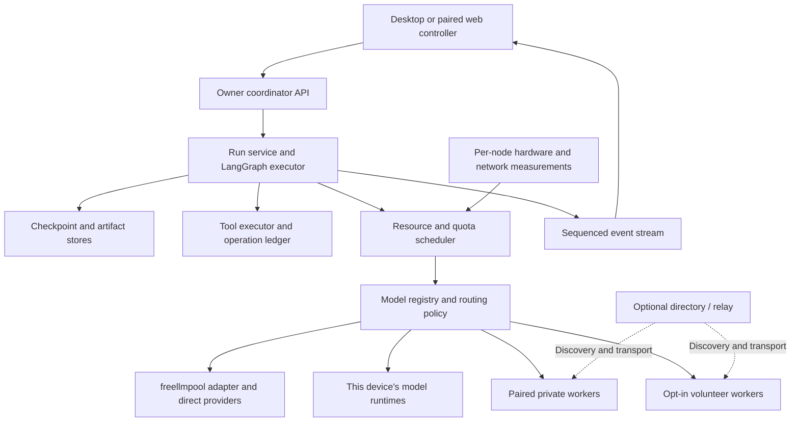

# Public Distributed Swarm Workbench: research and build plan

**0.3 update:** The current implementation and limitations are documented in [FEATURES_0_3.md](FEATURES_0_3.md), the earlier [0.2 guide](FEATURES_0_2.md) and [BUILD_STATUS.md](BUILD_STATUS.md). The source is MIT licensed. The research and phased design below preserve the original proposal; the historical checkpoint and planned capabilities are not claims that every integration has been physically validated.

Research date: 11 October 2026. Status: Windows x64 downloadable desktop alpha implemented, with installer, portable package, and headless worker; see README.md for setup and remaining release work. Hardware recommendations are generated for each installation rather than tailored to the developer's machine.

## 1. Product decision

Build a publicly available, general-purpose distributed swarm workbench with coding and research presets. Recommend an open-source core, desktop clients targeting Windows, Linux, and macOS, and a headless worker that users can run on additional computers or servers. Release platform builds as their support matrix is validated; the developer's operating system and hardware do not define the product requirements.

Users can combine their own local models, linked private devices, their own free-provider accounts, and an optional public volunteer compute pool. The application should work without a mandatory paid subscription or centrally hosted inference service. Public distribution, private-device networking, and public compute participation are distinct product capabilities.

### Multiple accounts and credential profiles

Allow several API-key profiles for the same provider, including keys belonging to different Google accounts. Keep account labels, credential IDs, selected models, and provider health separate from quota scope. Google limits are per Cloud project; keys and account labels do not automatically create independent capacity. Group known sibling keys by project ID and unknown scopes conservatively by provider. Apply provider 429 cooldowns to the entire declared group, and reject duplicate keys. Each installation uses its owner's credentials rather than a central cross-user key pool.

The first alpha supports manual project/organization/account scope IDs, native OS key storage, and explicitly selected session-only keys. It does not implement OAuth account login or automatically verify project ownership. A future provider-permissions flow may verify IDs and observed quota without assuming that each account or key has its own allowance. Local request counters are estimates and do not include use outside this app. Gateways that conceal downstream route/pricing are excluded from the alpha's free-only policy.

### Historical 0.1 implementation checkpoint

The downloadable alpha has a Tauri desktop window with a frozen Python engine, editable acyclic graphs, LangGraph/SQLite execution and restart recovery, individual agent chat/model assignment, direct provider and freellmpool proxy adapters, shared credential quota groups, hardware budgets/Ollama management, and a paired private inference-worker protocol. A configurable TLS listener exposes only worker endpoints. The Windows installer and portable desktop/worker packages include runtimes and dependency notices. Coding/research are instruction presets at this stage; execution tools and live browsing are pending. Public volunteer execution, WAN relays, sharded models, signed updates, and validated macOS/Linux packages remain future work. The offline demonstration is explicitly scripted and is separate from live inference.

An agent is a persistent identity with a task, instructions, conversation, tools, and work products. A model is a replaceable inference backend. Several agents can share one loaded model while keeping their conversations separate. This distinction makes the requested continuation, individual-agent chat, and limited-memory execution possible.

The first complete release should provide:

- A provider setup flow and an explicitly free-only run mode.
- Hardware discovery, editable RAM/VRAM budgets, local model recommendations, download progress, loading, and unloading.
- Persistent swarm runs, per-agent conversations, model replacement, and recovery from provider failure.
- A persistent agent bar, an agent inspector, a task/artifact view, and a visual architecture editor.
- Built-in architectures and user-created, importable/exportable architectures.
- Coding and research tools with practical isolation and review controls.
- Secure pairing of additional devices, per-device resource budgets, and model placement across a private pool.
- An opt-in public worker/network mode, released after private distributed execution is reliable.

Local inference consumes the user's machine resources. Remote free capacity depends on each provider's actual account allowances. The product should display available capacity rather than promise unlimited inference.

### Public product and distribution

Provide desktop installers, a downloadable headless worker, and a documented self-hosted coordinator. Package runtime dependencies so ordinary users do not need Python, Node.js, or Rust development environments. Keep large model weights as optional resumable downloads, not part of every installer.

First-run onboarding: choose local, remote, or hybrid execution; detect the current device; set resource budgets; connect the user's providers; select/download a fitting model; optionally pair other devices; then select a swarm template. Remote-only users must be able to proceed without a GPU or local model download.

The desktop client and native worker provide actual resource measurements. A browser device-memory signal is only approximate, as specified by the [W3C Device Memory API](https://www.w3.org/TR/device-memory/); do not use it as a local-model admission metric. A web client can control an explicitly paired native worker or self-hosted coordinator. Mobile/browser-only clients can be controllers first, without an inference-worker support promise.

Provider credentials stay with the owner's coordinator or credential-bearing device. The project must not ship a shared API key, aggregate unrelated users' free allowances, or make every user dependent on our developer account. A central volunteer directory/relay is optional and self-hostable; running it has infrastructure and bandwidth costs even when the software and inference contribution are free to users.

Public-release requirements include a dependency/license inventory, clean-machine install tests, platform-specific builds, integrity checks, migration/rollback tests, and a defined update path. [Tauri distribution](https://v2.tauri.app/distribute/) supports platform installers; its [updater](https://v2.tauri.app/plugin/updater/) requires signed update artifacts. Code-signing/notarization arrangements and any associated release costs must be resolved before promising a polished public installer on each platform. The project license is MIT; signing and hosting remain release-operator responsibilities.

## 2. Findings that change the design

### freellmpool is useful, but should be an adapter

[freellmpool](https://github.com/0xzr/freellmpool) provides a Python library, local proxy, provider catalog, quota-aware routing, failover, and tool-calling support. Its catalog includes recurring free tiers, trials, disabled entries, and optional keyless routes. A catalog entry is not proof that a user's account can call it for free. Its [package metadata](https://github.com/0xzr/freellmpool/blob/main/pyproject.toml) identifies version 0.13.0, Python 3.11+, and beta status at the time of research.

Its documented [local-runtime integration](https://github.com/0xzr/freellmpool#local-runtimes-explicit-pin-only) keeps imported local models out of automatic routing. Therefore, implement hardware-aware local scheduling in our application. Do not assume freellmpool already manages local/remote allocation for us.

Use an isolated adapter with a pinned, tested release. Before adopting its library interface, verify concrete-route selection, request cancellation, streamed tool-call reconstruction, actual selected-model reporting, and access to response headers. If those interfaces are insufficient, use its proxy behind the same adapter or add direct provider adapters. The workbench owns its free-only policy and must not allow a hidden fallback to bypass it.

### Free-provider lists age quickly

Primary provider documentation currently differs from some older free-API lists:

- [Cerebras](https://inference-docs.cerebras.ai/support/rate-limits) describes a $5 trial that expires after 30 days and requires a verified payment method; it explicitly says there is no permanently renewing free tier.
- [Hugging Face Inference Providers](https://huggingface.co/docs/inference-providers/en/pricing) currently lists no included monthly inference credits for free users. Hugging Face remains a useful source of downloadable weights.
- [Pollinations' current setup](https://github.com/pollinations/pollinations#-getting-started) asks users to obtain an API key. This does not establish that every legacy anonymous endpoint is unavailable, but it means we should not build the default experience around a claim of guaranteed keyless access.

Maintain a verified provider registry, with source URLs and last-checked dates. Separate advertised eligibility, credential presence, tested readiness, and observed remaining quota.

### Durable graph execution is a better fit than a fixed crew

Recommend [LangGraph](https://docs.langchain.com/oss/python/langgraph/overview) for graph execution. Its [persistence](https://docs.langchain.com/oss/python/langgraph/persistence), [interrupts](https://docs.langchain.com/oss/python/langgraph/interrupts), and [stateful subgraphs](https://docs.langchain.com/oss/python/langgraph/use-subgraphs) match resumable runs and interactive subagents. The application still needs its own domain schema, scheduler, tool ledger, and UI.

[CrewAI](https://github.com/crewAIInc/crewAI) remains an alternative for a quicker role-based prototype. [Microsoft Agent Framework](https://github.com/microsoft/agent-framework) is another current alternative with graph workflows and checkpointing. Choose one execution engine for the MVP. Avoid starting on AutoGen: its [repository](https://github.com/microsoft/autogen) currently says it is in maintenance mode.

This is a design recommendation based on documented capabilities, not a benchmark result.

## 3. Where the models come from

| Source | Access/setup | Free classification at research time | Intended use | Integration priority |
|---|---|---|---|---|
| [Ollama library](https://ollama.com/library) | Install the runtime; select and download a model | Local inference, no per-request API charge | Offline work, private data, steady baseline capacity | First |
| Linked private workers | Explicit device pairing; model/runtime installed on the serving node | User-controlled compute; per-node resource budgets | Run models on other devices and increase swarm concurrency | MVP |
| Public volunteer workers / [AI Horde](https://aihorde.net/) | Explicit opt-in; supported network/worker API | Contributed capacity, availability and capability dependent | Non-sensitive inference on volunteered resources | Controlled pilot |
| [Hugging Face GGUF models](https://huggingface.co/docs/hub/gguf) | Download a compatible quantization; inspect model card and license | Downloadable weights; hosting/inference is separate | Wider model catalog and advanced llama.cpp support | After Ollama |
| [Groq](https://console.groq.com/docs/rate-limits) | User supplies their own API key | Free-plan quotas; limits vary by model/account | Short worker turns and extra remote concurrency | MVP |
| [Gemini API](https://ai.google.dev/gemini-api/docs/pricing) | AI Studio project and API key | Selected models have a free tier; availability is model/account dependent | Larger-context tasks and multimodal work when eligible | MVP |
| [OpenRouter](https://openrouter.ai/docs/guides/routing/routers/free-router) | Account and API key; free model routes | Free models; free plan currently lists [50 requests/day](https://openrouter.ai/pricing/) | Extra models and fallback capacity | MVP |
| [Mistral](https://docs.mistral.ai/getting-started/quickstarts/studio/activate-and-generate-api-key) | Studio account and API key | Free mode with included usage and limits; no card required for activation | Another independent source of limited capacity | First expansion |
| [Cloudflare Workers AI](https://developers.cloudflare.com/workers-ai/platform/pricing/) | Cloudflare account and scoped API credentials | 10,000 neurons/day on the Free plan, with model-dependent consumption | Optional remote workers | First expansion |
| [NVIDIA Build](https://build.nvidia.com/explore/discover?modal=signin) | Developer account and API key | Free development endpoints under trial terms; verify model eligibility | Optional access to larger models | Experimental |
| Cerebras | Account and verified payment method | Expiring trial, not recurring free capacity | Optional user-selected trial | Excluded from default pool |
| Hugging Face hosted Inference Providers | HF account and purchased credits or eligible subscription | Free account has no included inference credits | Optional paid adapter later | Excluded from default pool |
| Anonymous/community endpoints | Provider-specific | Unverified until checked and tested | Optional experimentation | Disabled by default |

Each setup card should link to the provider's own account/key instructions and show whether it needs signup, a card, a regional check, or license acceptance. Never create accounts automatically or pool other people's credentials.

For local weights, store the repository/model reference, resolved digest or revision, quantization, download size, runtime requirements, and license. [Hugging Face gating](https://huggingface.co/docs/hub/models-gated) can require the user to accept access conditions. Model access and license eligibility are separate checks.

### Routing and quota policy

The application filters eligible routes before ranking them:

Apply execution/data scope independently of price mode: this device, owned devices, a named private pool, selected hosted providers, or public volunteers. Node membership and permission, network health, and per-node fit are admission requirements. "Free hybrid" alone never authorizes sending a private task to a public worker.

1. Apply user mode: local only, free remote only, or free hybrid. Paid routes remain excluded unless the user deliberately enables a separate paid mode later.
2. Filter by tested capabilities: tool calls, structured output, vision, supported context, and cancellation behavior.
3. Apply data-routing and node-trust settings. This-device-only tasks stay on that device, including summaries and retrieval calls; a private-pool task can use only its permitted nodes.
4. Check provider/node health, quota scopes, per-node memory, queue and network state; reserve capacity or obtain a worker lease for the pending request.
5. Prefer the current model for conversational stability. Change only on user instruction, failure, unsuitable capability, or a material scheduling reason.
6. Rank remaining routes by measured task success, latency, headroom, and local pressure. Use deterministic rules initially rather than spend an LLM call on every routing decision.
7. Record the concrete selected model, reason, attempt cost, token usage, and any retry.

[Gemini limits](https://ai.google.dev/gemini-api/docs/rate-limits) are per project, with daily reset at midnight Pacific time. [Groq limits](https://console.groq.com/docs/rate-limits) apply at organization scope. Multiple keys or model aliases must not be counted as independent allowances. Preserve documented reset timezones and actual Retry-After/reset headers; do not impose a universal UTC reset.

Use an application quota ledger with atomic reservations, configurable local ceilings, and honest "estimated" or "unknown" indicators. A generic router's counters are advisory when they differ from provider windows. Failed attempts can still consume provider capacity. Bounded retries and cooldowns prevent one failing route from consuming the entire pool.

Free-only mode must also filter optional paid features, such as provider-hosted tools or paid search/grounding. It cannot universally guarantee a provider's future pricing; require verified free eligibility and disable routes whose pricing status becomes uncertain.

## 4. Per-user hardware discovery and model placement

### Public support and test profiles

Hardware selection happens on every participating device. No specific CPU, GPU, installed runtime, or fixed memory allocation is a product default.

| Profile to validate | Expected product behavior |
|---|---|
| Remote-only / no local runtime | Run swarms through configured APIs or linked workers without downloading weights |
| CPU-only computer | Recommend small fitting models, bounded context, and measured CPU concurrency |
| Discrete GPU with limited VRAM | Select fitting quantizations, constrain concurrent contexts, and optionally offload |
| Large or multiple discrete GPUs | Use runtime-supported placements and measured per-device capacities |
| Apple unified-memory device | Treat shared CPU/GPU memory as one physical pool, avoiding double-counting |
| AMD / Intel or unavailable telemetry | Detect supported runtime backends; show confidence/unknown metrics and use conservative admission |
| Mixed linked devices | Schedule suitable models on each node; display independent capacities and ownership |

Define a published support matrix by OS, architecture, runtime, and acceleration backend. Validate CPU and remote-only paths across supported OSes early; promote specific GPU combinations to supported status after real-device testing. CI mocks cover detection logic, but cannot substitute for hardware compatibility tests.

### User controls

The Hardware panel should show total memory, current availability, observed runtime usage, estimated reservations, and the user's budget as separate values. RAM/DRAM should be labeled "System RAM" in the interface; dedicated VRAM and shared/unified memory should be distinguished.

Expose:

- Maximum local VRAM and system RAM budgets, in GiB.
- CPU thread limit and maximum concurrent local generations.
- Maximum loaded model count, context length, and idle-unload timeout.
- Disk download allowance and model storage location.
- GPU preference, CPU-only mode, and an opt-in CPU-offload mode.
- Automatic, responsive, or maximum-throughput resource presets.

Consumer GPUs generally cannot reserve an exact isolated VRAM slice for this application. These controls are runtime-aware admission budgets: estimate, measure, queue, shrink context, unload idle owned models, and stop admitting work when pressure rises. Shared Ollama/LM Studio services offer less ownership and attribution than a managed runtime. The interface must not represent a budget as a hardware partition.

### Discovery and admission flow

1. Detect OS, available RAM, CPU, disk space, GPUs, driver/backend support, and known local runtimes.
2. For NVIDIA, prefer [NVML bindings](https://docs.nvidia.com/deploy/nvidia-smi/index.html) and fall back to nvidia-smi. Use [psutil](https://psutil.io/) for RAM, CPU, and process measurements. Define platform-specific AMD, Intel, and Apple adapters and capability flags; show unsupported/unavailable metrics explicitly and never treat them as zero usage or infinite capacity.
3. Discover installed model manifests from configured runtimes. Restrict initial discovery to explicit loopback addresses and configured paths.
4. Estimate total load: weights, attention/recurrent state, context/KV cache, generation concurrency, compute buffers, and optional vision components. Handle the model architecture rather than assume every model has the same cache formula.
5. Compare the estimate against the user budget and current external memory pressure. Reserve capacity before starting a load or generation.
6. Warm-load one candidate; run a short tool/schema probe and a small representative task; measure actual memory and latency.
7. Adjust recommended context/concurrency and retain the measured profile by model digest, runtime version, and hardware.
8. Use reference-counted model leases. Unload only models that the application owns and that have no active generations; honor idle TTL.

Ollama supports model lifetime controls and reports loaded CPU/GPU placement. Its documentation also explains that parallel contexts increase memory requirements. Use its [native API](https://docs.ollama.com/api/chat) for runtime controls rather than only its generic chat compatibility endpoint. [FAQ](https://docs.ollama.com/faq), [running-model API](https://docs.ollama.com/api/ps).

For advanced management, [LM Studio's estimate-only load](https://lmstudio.ai/docs/cli/local-models/load) can preview resource requirements. [llama.cpp server](https://github.com/ggml-org/llama.cpp/blob/master/tools/server/README.md) exposes memory-fit margins and GPU-offload controls. Add these as separate runtime adapters after the first Ollama path works.

### Adaptive defaults and catalog candidates

Derive initial budgets from available memory, configurable OS/application headroom, and the user's selected resource preset. Begin with conservative local concurrency, then increase only after a measured load and representative generation succeed. The chosen model, context, number of resident models, and concurrency are installation-specific and can differ across linked devices.

Recommend the smallest tested model that meets the task's capabilities and quality target. Show alternatives for responsiveness, quality, and memory usage; allow the user to override. Recommend graph fan-out separately from simultaneously running model requests: many logical agents can share a smaller number of inference slots.

Illustrative catalog candidates, not global defaults:

| Candidate | Current advertised download size | Recommendation |
|---|---|---|
| [Qwen3.5 4B](https://ollama.com/library/qwen3.5) | Approximately 3.3–4.0 GB across listed variants | General-purpose tools/vision candidate for fitting devices |
| [Qwen3 4B](https://ollama.com/library/qwen3) | Approximately 2.5 GB | Smaller text-focused compatibility candidate |
| Qwen3 8B | Approximately 5.2 GB on the same library page | Larger text candidate after memory and quality measurements |
| Qwen3.5 9B | Approximately 6.6–7.6 GB across listed variants | Larger tools/vision candidate when measured memory permits |
| [Qwen3-Coder 30B](https://ollama.com/library/qwen3-coder) | Approximately 19 GB | Coding candidate for suitable larger-memory nodes or supported distributed backends |

Download sizes are not runtime memory requirements. Sparse/MoE active parameter counts do not mean only the active parameters occupy memory. Store exact digests rather than silently following a moving `latest` tag.

## 5. System architecture and technology choices



| Layer | Choice | Reason |
|---|---|---|
| Interface | React + TypeScript + Vite | Responsive agent panels and shared browser/desktop UI |
| Graph editor | [React Flow / XYFlow](https://reactflow.dev/learn) | Nodes, edges, selections, and custom graph controls |
| Coordinator / worker API | Python FastAPI + asyncio + Pydantic | Fits the Python provider/runtime ecosystem; typed and versioned network validation |
| Graph runtime | LangGraph behind our execution interface | Explicit state, conditional execution, checkpointing, and interruption |
| Model adapters | freellmpool, native Ollama, generic compatible API | Reuse provider work while keeping policy and state under our control |
| Persistence | SQLite and artifact files for each owner's coordinator | No database installation for a personal/private pool; public service storage is a separate deployment concern |
| Hardware | psutil + nvidia-ml-py + OS adapters | Detect current capacity and monitor pressure |
| Secrets | OS credential store through a tested keyring backend | Provider keys stay out of browser storage and exported architectures |
| Desktop packaging | [Tauri 2 with a Python sidecar](https://v2.tauri.app/develop/sidecar/) | Native cross-platform clients with bundled backend dependencies |
| Headless worker | Same Python runtime, packaged independently | Additional computers and servers contribute models without running a desktop UI |
| Private transport | Authenticated TLS channel, direct LAN or outbound connection | Explicit pairing, model-serving RPCs, and job/event streaming |
| Public coordination | Separately deployable directory, lease queue, and bounded relay | Optional volunteer participation without a mandatory central inference server |
| Testing | pytest + frontend component checks + Playwright workflows | Recovery, routing, and interactive UI are the important integration seams |

Develop the UI against a loopback coordinator first, then validate the same API over authenticated private-worker channels. Package the same interface as desktop clients. Test package builds early on the target OS matrix rather than discover portability problems at the end. Personal and LAN/private execution need no project-hosted cloud service; optional public rendezvous/relay services have their own operations budget.

Backend launch should use an ephemeral loopback port and a per-launch authentication token. Serve the production UI through the backend or use an authenticated same-origin bridge, restrict origins, and keep the token out of URLs. Launch background helpers hidden on Windows. Manage only owned processes; do not modify persistent user/system runtime settings.

### Application contracts

Define these before building the polished UI:

| Record | Essential fields |
|---|---|
| ModelRoute | Provider, concrete model, revision, capabilities, context, free classification, quota scopes, health, source/verification timestamps |
| HardwareProfile | Device/backend support, total/available memory, metric confidence, user budgets, measured model profiles |
| ArchitectureDefinition | Schema version, graph revision, node/edge definitions, typed ports, limits, model policies, tool permissions |
| AgentSession | Stable agent ID, role, parent/task IDs, private conversation, mailbox, model policy, actual model, checkpoint reference |
| RunState | Run/branch IDs, pinned graph revision, goal, task states, shared facts, artifact refs, remaining budgets |
| ToolOperation | Stable operation ID, input hash, permission scope, requested/started/completed/uncertain status, result/artifact refs |
| RunEvent | Monotonic sequence, timestamp, run/agent/node IDs, event kind, payload, state revision |
| Artifact | Content hash, path/type, producer, version, provenance, validation status |
| WorkerNode | Stable public-key identity, pool membership, trust scope, protocol version, runtime/model inventory, per-node budgets, live capacity, network health |
| JobLease | Job/attempt IDs, node ID, expiry, fencing generation, input hash, checkpoint reference, resource reservation, completion status |
| ArtifactGrant | Run/node scope, artifact digest, allowed access, expiry, revocation state |

Use separate agent checkpoint namespaces and one writer per stateful agent thread. Parallel workers should return explicit results; merge through reducers rather than overwrite each other's global state. Application commands carry expected revisions and idempotency IDs. Reconcile checkpoint references and event projections during restart instead of assuming independent persistence writes are atomic.

## 6. How models continue from other models' work

Continuation has three distinct cases:

- **Same agent, new model:** keep the identity, task, mailbox, tool ledger, and artifacts; replace the inference route.
- **Task handoff to another agent:** give the receiving agent a scoped task packet and relevant artifacts; it keeps its own identity and tools.
- **Branch from a checkpoint:** copy the selected state into a new run branch, with new ownership and operation policy.

Every completed model/tool step commits a portable checkpoint. Its continuation packet contains the goal and completion criteria, current instructions, completed/pending work, concise decisions and evidence, recent conversation, relevant tool outputs, artifact versions, remaining budgets, and the next intended action. Maintain provenance and a compaction revision so a summary can be audited against source events.

Store large files and tool outputs as artifacts. Assemble only relevant excerpts for the next model, accounting for that model's tokenizer, input limit, system/tool overhead, and reserved output tokens. Summary generation itself consumes capacity; prefer structured checkpoints and deterministic extraction before asking another model to summarize.

A different model resumes from persisted external state. Hidden reasoning, provider-internal caches, and internal model state are not portable. The UI should explain this as "continue from saved work".

### Switch/failure procedure

1. Stop admitting new steps for the target agent; finish or cancel the current inference.
2. Commit completed tool results and establish a consistent checkpoint. Reconcile uncertain operations before proceeding.
3. Select a compatible model under the same free/data/tool policy.
4. Rebuild valid messages and tool-call/result pairs for the destination API. Never forward opaque provider-specific reasoning items blindly.
5. Provide the continuation packet and continue with the next outstanding step.
6. Record and display the reason, old/new models, and checkpoint.

Before the first streamed token, fallback can retry the request. After partial output is visible, retain it as an interrupted attempt and regenerate an uncommitted step; do not splice two models' token streams together or execute incomplete tool-call JSON.

Tool execution needs stable IDs and reconciliation. [LangGraph interrupts can re-run node code](https://docs.langchain.com/oss/python/langgraph/interrupts), so put non-idempotent actions into separate guarded operations. For a crash after an external action but before its result is persisted, mark it uncertain and verify or request a scoped decision. Do not promise exactly-once external effects without destination support.

## 7. Agent bar and individual interaction

The agent bar remains visible across Chat, Graph, Tasks, Artifacts, and Hardware views. Each item shows name/role, actual model, state, current task, and unread messages. States distinguish working, using a tool, queued for local memory, cooling down for quota, paused, waiting for user input, completed, and failed.

Illustrative layout:

```text
Project | Architecture: Supervisor | Free hybrid | Pause | Stop
Planner · local   Researcher · remote   Builder · queued   Reviewer · idle
-----------------------------------------------------------------------
Tasks / files | Main conversation or graph | Selected agent inspector
              | Final outputs / artifacts | Conversation, task, tools,
              |                           | model policy and controls
-----------------------------------------------------------------------
VRAM used/budget | RAM used/budget | Local queue | Provider quota/status
```

Clicking an agent opens its own conversation, assignments, model history, current serving device/provider, permitted tools, files, and trace. Provide send instruction, pause/resume, cancel task, switch model/device, rerun from checkpoint, and delegate another task. Selecting an agent only inspects it; it should not automatically start another generation. A Devices panel exposes pairing, model placement, budgets, connection health, worker contribution, and revocation.

Support two clearly labeled message modes:

- **Steer agent:** queue a durable instruction to the agent's mailbox and apply it at the next consistent step boundary. The UI shows queued/applied status. Relevant task changes are reported to the coordinator.
- **Ask about progress:** use a read-only state snapshot or an isolated side conversation. It does not silently change the agent's assignment or shared state. Any inference for this mode goes through the same resource scheduler.

Serialize operations on one agent's conversation. Persist user steering so it survives restart. Provide an explicit broadcast-to-selected-agents action rather than copy every user message to the entire swarm.

The inspector shows visible conversation, tool activity, source evidence, structured progress, and outputs. Do not require or fabricate a hidden reasoning transcript. Agent labels and state must be keyboard accessible; large swarms use grouping, filtering, and a virtualized list.

Use HTTP commands plus SSE for initial event streaming, with sequence IDs and reconnect replay. Add WebSockets only if terminal/interactive streaming requirements justify them. Persist committed events; coalesce transient token deltas to avoid a database write for each token.

## 8. Built-in and custom swarm architectures

Common patterns are documented by [LangChain](https://docs.langchain.com/oss/python/langchain/multi-agent) and [Anthropic](https://www.anthropic.com/engineering/building-effective-agents). Our templates should expose the following behaviors:

| Architecture | Behavior | Best use | Cost/resource behavior | Stage |
|---|---|---|---|---|
| Sequential pipeline | Defined stages pass results forward | Research → outline → draft → check | Predictable; works well with one local generation | MVP |
| Supervisor/workers | A coordinator assigns tasks and combines results | General-purpose and coding work | Flexible, but adds coordinator turns | MVP |
| Parallel fan-out/fan-in | Independent workers, then a merge step | Research topics, independent reviews, document sections | Faster only when inference capacity allows; local work can queue | MVP |
| Generator/critic | Produce, evaluate, revise under a bounded loop | Writing, coding, answer verification | More calls; cap rounds and require useful feedback | MVP |
| Handoff network | Specialists transfer task/control explicitly | Multi-domain interactive work | Requires well-defined state ownership | Next |
| Hierarchical teams | Coordinators manage teams with local task scopes | Large projects | Greater coordination overhead; cap depth and spawned agents | Next |
| Debate/ensemble | Independent answers, limited critique, synthesis/vote | Ambiguous decisions and comparison | High token usage; agreement is not proof | Next |
| Shared blackboard | Workers read/write structured shared findings | Open-ended investigation | Needs provenance, conflict resolution, and claim versioning | Advanced |

Include a single-agent baseline in every architecture comparison. The recommended default is a small supervisor/workers template, not the largest possible swarm.

### Custom editor and validation

The visual editor and JSON/YAML definition represent the same versioned schema. Users can add roles, model policies, tools, typed inputs/outputs, conditional routes, fork/join behavior, bounded loops, and human-input nodes. Prefer portable named condition operators over arbitrary executable expressions in imported graphs.

Node types: agent, deterministic tool, route, fork, join, evaluator, user gate, bounded loop, and end. Distinguish a conversation/control handoff from a task dependency or artifact transfer. Joins define all/any/quorum completion and timeout/failure policy.

Validate missing references, unreachable nodes, incompatible port types, no terminal path, unbounded cycles, missing required tools, capability mismatches, and impossible resource policies. Estimate likely request volume before running, labeling estimates as such. A dry-run simulator should use mock models and show the order of tasks without consuming quotas.

Every run pins an architecture revision. When the user edits a running architecture, save a new draft. The MVP applies it on the next run or a new branch. Later support pause-at-checkpoint migration only for compatible changes with an explicit state mapping. Immediate arbitrary rewiring of in-flight execution is excluded from the first release.

## 9. Coding and research presets

### Coding

Planner → scoped implementer(s) → test runner → reviewer → final patch/artifacts. Expose changed files, diffs, actual test output, and conflicts in the main window. Use per-task worktrees or explicit file ownership when agents edit in parallel; one integrator applies combined changes.

Start with filesystem reads, bounded search, patch creation, and allowlisted test commands in a chosen project. A subprocess alone is not a sandbox. Add isolated execution through containers or an OS-supported boundary before granting broad untrusted code execution. Workspace changes remain reviewable, with commit/publish/merge treated as distinct user actions.

### Research

Coordinator → scoped researchers → source checker → synthesizer. Maintain a source ledger with URL, retrieval date, excerpt location, claim, producer, and verification state. The output carries citations and distinguishes evidence from inference.

Model access and web search are separate services. MVP research can accept user-provided URLs/documents and fetch public pages. Open-web search should be a configurable adapter with its own cost/limits; do not assume a free LLM key includes unlimited search. Add document extraction and retrieval incrementally.

## 10. Suggested additional features

| Feature | Why it helps | Priority |
|---|---|---|
| Provider/model doctor | Tests tools, JSON, context, streaming, and current free eligibility | MVP |
| Quota/resource preview | Explains expected agent calls, active generations, and likely queues | MVP |
| Explain routing | Shows why a model was chosen, skipped, or replaced | MVP |
| Emergency stop | Stops new inference and terminates owned cancellable tool processes | MVP |
| Artifact history | Shows which agent produced/changed each file or conclusion | MVP |
| Checkpoint branching/replay | Compare a different model or architecture from saved work | Next |
| Architecture benchmark lab | Compare success, time, tokens, handoff retention, and hardware load against a single-agent baseline | Next |
| Local knowledge/retrieval | Reuse project material without replaying huge prompts | Next |
| MCP tools | Extend capabilities through selected servers and per-agent tool scopes | Next |
| Existing-agent adapters | Use external coding agents through [ACP](https://agentclientprotocol.com/get-started/introduction) where supported; capability gaps remain visible | Next |
| Low-quota mode | Reduce fan-out and critiques, shorten outputs, schedule around real resets | Next |
| Offline queue | Keep pending work and resume when eligible capacity returns | Next |
| Template library | Save role prompts, graph definitions, and benchmark results | Next |
| Thermal/battery mode | Reduce local generations under laptop pressure | Later |
| Private linked-device pool | Load models on other owned/paired computers and schedule agents across them | MVP |
| Public volunteer pool | Opt-in sharing of bounded model-serving capacity, with separate trust and fairness policies | After private-pool validation |
| Distributed model backend | Optional sharding of one model across compatible nodes | Experimental expansion |

MCP connects tools; ACP connects clients and agents. Neither makes an external agent's private state portable by itself. Initially wrap external agents as bounded task workers with artifact handoffs rather than promise identical pause/resume behavior.

## 11. Implementation sequence

The public distributed product needs separate release gates for the core workbench, private-device pools, and public participation. Calendar estimates should follow the integration and distributed-protocol spike; signing, hardware access, interoperability, and volunteer-service operations are unresolved dependencies.

| Milestone | Dependency | Deliverable | Exit criteria |
|---|---|---|---|
| 0. Validate public-product seams | Start | Hardware/runtime support fixtures, package spike, provider adapters, two-node protocol experiment | CPU/remote-only flow, model swap, cancellation, and authenticated two-node inference demonstrated; unavailable hardware/accounts recorded |
| 1. Durable run foundation | 0 | Typed records, SQLite persistence, one agent, task/artifact service, sequenced events | Restart restores conversation/task state; tools have stable operation IDs; no secret appears in events |
| 2. Provider pool and local manager | 1 | freellmpool/direct adapters, adaptive quota/resource admission, local download/load/unload | Free-only policy survives retries; hardware recommendations adapt; loads respect per-node budgets and leases |
| 3. Private distributed pool | 1–2 | Pair/revoke devices, headless worker, inventory, remote loads, job leases, result streaming | Models run on two linked devices; worker loss resumes saved work elsewhere; stale results and duplicate effects are rejected |
| 4. Interactive swarm and editor | 2–3 | Agent bar/chat, device-aware routing, four templates, custom graphs, coding/research presets | User steers one worker without disrupting siblings; architecture is versioned; real artifacts/evidence produced |
| 5. Publicly distributable private-pool beta | 4 | Platform packages, clean-machine onboarding, docs, diagnostics, migrations and recovery | Validated OS builds install without development toolchains; paired devices reconnect safely; supported hardware matrix published |
| 6. Public volunteer pilot | 3–5 | Opt-in worker registry, bounded queue/relay, fairness, validation and contribution controls | Non-sensitive jobs cross owners; consent/revocation works; quota/abuse/resource limits and hosting budget validated |
| 7. Model-sharding experiments | Stable private pool | Exo/Petals or other backend adapter on documented supported configurations | Actual memory placement, network cost, failure behavior and tool compatibility measured; no universal aggregate-VRAM claim |

First executable slice: install the client, select a pipeline/supervisor preset, choose a workspace, detect that user's hardware, connect local/free sources, pair a second worker, start three logical agents, place one model on each suitable device, steer one agent, replace its model/device, and recover the same run after a worker disconnect or coordinator restart.

### Repository layout

```text
apps/ui/                 React interface and graph editor
apps/desktop/            Tauri shell and sidecar launcher
backend/workbench/api/   Local command and event APIs
backend/workbench/core/  Domain records, commands, and policies
backend/workbench/graph/ Compiler, templates, and LangGraph integration
backend/workbench/models/Registry, freellmpool/direct-provider adapters
backend/workbench/local/ Hardware, model loading, memory scheduling
backend/workbench/network/ Pairing, worker protocol, leases, connection handling
services/coordinator/    Optional self-hosted directory, public queue, and relay
backend/workbench/tools/ Tool adapters, operation ledger, execution boundaries
backend/workbench/store/ Persistence, events, artifacts, migrations
schemas/                Architecture and interchange schemas
presets/                Coding, research, and general templates
tests/scenarios/        Recovery and workflow acceptance cases
docs/                   Research, decisions, setup, and user documentation
```

### Validation that matters

- Force a provider 429 before output, and a disconnect after partial output. Check bounded attempts, quota reservations, interrupted output labeling, and correct continuation.
- Replace model A with model B after a completed tool step. Verify retained goal, artifact versions, user steering, and no repeated completed operation.
- Crash after tool start and before result persistence. Verify uncertain-action reconciliation rather than blind replay.
- Run several logical agents on one resident model. Check isolated conversations, one writer per thread, fair queuing, and truthful status.
- Increase external GPU/RAM pressure. Reject/queue new work and recover without an unload during active generation.
- Confirm free-only and local-only policies apply to fallbacks, summaries, retrieval, and optional provider tools.
- Reject invalid/unbounded custom graphs; validate fork/join and failure policies.
- Reconnect the UI from an event sequence and restore one coherent state.
- Complete a small coding task with verifiable diffs/tests and a research task with a checkable source ledger.
- Test clean-machine desktop/worker packages on the supported OS matrix, including helper startup and owned-process shutdown.
- Pair and revoke a second device; reject unauthorized/expired peers, incompatible protocols, and stale job leases.
- Disconnect a worker during loading, inference, and result delivery; recover without corrupting the agent conversation or repeating completed tools.
- Test mixed model/runtime nodes, asymmetric capacities, and network partitions. Do not add different GPU memories as a single-model fit claim.
- Confirm public jobs require explicit routing permission and do not receive private credentials or implicit workspace access.
- Validate update integrity, database migration/rollback, export/import portability, and secret-free public diagnostics.

Use deterministic mock providers for failure scenarios and a small manually triggered live compatibility suite. Routine tests should not burn remote quotas or download models.

## 12. Decisions to lock before implementation

Already established: a public general-purpose tool, coding/research presets, per-user hardware discovery, free-provider pooling, editable per-device budgets, portable saved work, individual agent interaction, configurable architectures, linked devices, and optional public distributed participation.

Recommended defaults: Python/LangGraph coordinator; React/React Flow interface; freellmpool behind a replaceable adapter; native Ollama path first; SQLite per owner/private pool; cross-platform Tauri clients and headless workers; four architecture templates; adaptive per-device model selection; private-device execution before an opt-in public volunteer pilot. Recommend an open-source core; the core is now MIT licensed; central-service funding remains a deployment decision.

Account-dependent facts remain unresolved until each user connects their own providers. Model performance and actual memory fit require representative probes on each supported hardware/runtime profile. Distributed execution requires measured node/network capability. Do not freeze provider/model assumptions in application code: verify metadata, retain exact revisions, and expose readiness and confidence in the interface.

The first implementation step is milestone 0, followed by the durable single-agent foundation and worker protocol. The UI and swarm patterns build on the same portable state, event, scheduling, and ownership contracts. Section 13 specifies the linked-device and public-network behavior.

## 13. Linked devices and public distributed execution

### Three supported execution arrangements

| Arrangement | Membership | Placement behavior | Release |
|---|---|---|---|
| Personal device pool | Computers explicitly paired by one owner | Load compatible models on any eligible owned node; route agent generations across them | MVP |
| Private shared pool | Explicitly invited people/devices with scoped access | Owners retain their own resource caps; runs use only nodes allowed by the task policy | After personal pairing, same protocol |
| Public volunteer pool | Opt-in model workers accepting scoped public jobs | A directory/queue matches non-sensitive inference work to available volunteered capacity | Separate controlled pilot |

The workbench's public availability does not automatically opt a user into sharing compute or sending tasks to strangers. Private use works independently of the public pool. Contribution and consumption are separate switches.

### Two kinds of distribution

**Distribute inference requests and agent work.** Each worker loads complete models that fit that worker. For example, a coordinator can place research generations on a desktop, coding generations on a second computer, and lightweight checks on a CPU worker. A control-only laptop or browser can display all agents. The same model can be replicated on two workers for throughput, or different models can be resident on different workers. This is the default distributed design.

**Distribute a single model.** A specialized backend can place layers or tensors of one model across compatible machines. Networking, supported model formats, backend versions, and placement constraints become part of model admission. An 8 GiB GPU plus a 12 GiB GPU does not automatically provide a usable 20 GiB model allocation.

Research candidates:

- [Exo](https://github.com/exo-explore/exo) exposes model sharding, topology-aware placement, and compatible APIs. Its [platform matrix](https://github.com/exo-explore/exo/blob/main/PLATFORMS.md) and current backend support must be tested for the intended device combinations. Integrate as an optional backend rather than assume all mixed-OS/GPU clusters are supported.
- [Petals](https://github.com/bigscience-workshop/petals) supports collaborative model-layer inference and private/public swarms. A public swarm processes data on other people's machines; it is not a private execution environment.
- [AI Horde](https://aihorde.net/) is an existing volunteer network for text/image generation and an example of contribution-based public capacity. Evaluate its text API, available models, latency, conversation encoding, and actual tool/schema support before qualifying it for agent roles. Its existence does not establish drop-in tool-calling compatibility.

Default to request-level distribution because it can connect heterogeneous workers through one model-serving protocol. Evaluate single-model sharding in a later measured experiment. A backend adapter can expose a sharded model as one route, while still reporting its member nodes and reservations.

### Pairing and worker lifecycle

Install a desktop client or headless worker on the additional device. Generate a device identity locally. Use a short-lived invite/QR containing a single-use pairing secret, coordinator identity/fingerprint, requested membership, and expiry. The joining device owner confirms the target pool and permitted contribution. The coordinator binds the device identity to that pool and issues scoped, revocable credentials.

Discovery can suggest LAN peers, but it does not establish trust or authorize a join. Pairing is required before model inventory, prompts, or files are exchanged. Support manual addresses and outbound connections for remote devices. Expose revoke, leave pool, rotate credentials, and drain/stop contribution controls.

A worker advertises:

- Protocol/runtime versions and supported hardware backends.
- Downloaded and resident models by exact revision/quantization.
- Tested tools/schema/vision/context capabilities.
- Owner-assigned RAM, VRAM, CPU, disk, concurrency, and network budgets.
- Current available capacity, queue length, load latency, and health.
- Allowed hours, idle-only/battery behavior, trust scope, and download policy.

Heartbeats expire. Never treat the last reported free memory as a permanent entitlement. Inventory is metadata; the worker remains authoritative for whether a requested load or generation can be admitted.

### Model placement and distributed scheduling

The coordinator ranks candidate node/model pairs using permission scope, model capability, resident-model reuse, live capacity, queue delay, expected load/download cost, measured generation quality/latency, and network transfer cost. A node's owner settings are hard policy boundaries; a coordinator cannot raise them.

The worker performs final admission and issues a resource/job lease. Each job carries stable job and attempt IDs, an input digest, required model revision, deadline, maximum output, run/agent identity, checkpoint reference, and a monotonically changing lease/fencing generation. Job acceptance, running status, token deltas, cancellation, completion, and errors use a versioned protocol.

Keep graph execution and durable task ownership at one coordinator initially. Workers serve inference requests, which makes models replaceable and keeps tools and durable state consistent. Later permit bounded full-agent tasks on trusted private nodes with explicit checkpoint/artifact exchange. Public workers initially expose inference only, with no shell, filesystem, browser session, or provider-key access.

At-least-once delivery and retries are expected. Accept only a completion matching the current job attempt/lease; discard stale or duplicate results. Enforce one writer per agent conversation. Store canonical checkpoints and committed outputs at the coordinator. A disconnected worker can be replaced at a saved step boundary; internal model caches and partially generated responses are not migrated.

If the coordinator disconnects, workers finish or cancel only within their existing leases and retain bounded result buffers. They do not start new orchestration autonomously. Resume after reconnection or an explicit coordinator transfer from a validated checkpoint. Automatic leader election and consensus are outside the first release; checkpoint replication/coordinator migration can be added without pretending there is a shared transactional filesystem.

### Networking and artifact transfer

Start with authenticated TLS channels and direct private LAN connections. Add an outbound worker connection to a self-hostable coordinator/relay for WAN pairing; this avoids requiring every worker to expose an inbound port. Bound relay bandwidth, result buffering, connection count, and job payload size.

Direct peer connections can be an optimization. [libp2p circuit relay](https://github.com/libp2p/specs/blob/master/relay/circuit-v2.md) and [DCUtR hole punching](https://github.com/libp2p/specs/blob/master/relay/DCUtR.md) are relevant established protocols, but direct connectivity is not universal. Do not build a novel P2P transport before the worker protocol and scheduling are proven. Relay use must appear in latency/bandwidth accounting.

Transfer only task-scoped artifacts using expiring grants, content hashes, size/type limits, and explicit destination paths. A public inference worker receives the admitted inference input, not an implicit copy of the project. Private workers obtain workspace access only when the owner grants it. Network encryption protects transit; the machine doing inference can still see the submitted input and must satisfy the user's trust policy.

### Public participation and fairness

Use separate data/placement settings: this device only, owned devices, named private pool, selected hosted providers, or public volunteers. Public routing requires explicit selection for the run/task and a visible destination/trust indicator. Local/private requirements also apply to summaries, embeddings, retries, and source extraction. Secret detection/redaction can assist the user but does not prove arbitrary data is safe to publish to a worker.

Public workers choose offered models, resource limits, hours, accepted request types, and whether model downloads are allowed. Accept only approved model artifacts/revisions from allowed sources; a remote job cannot supply an executable download or silently install a model. Contribution must remain bounded and stop promptly when the owner pauses or revokes it.

The public coordinator needs bounded jobs, admission quotas, authenticated identities, queue fairness, timeouts, invalid-result handling, and resource-use accounting. A contribution-credit scheme is optional for fair access; no cryptocurrency or account-farming mechanism is needed. A worker signature identifies who returned a result, not whether the model or answer is correct. Combine compatibility probes, structural validation, task-specific verification, and sampled redundant checks where their extra compute is justified.

Publish directory/relay software and its deployment requirements. Offer federation or user-chosen directories later. A public pool's available models and capacity fluctuate, so display live readiness and queue estimates rather than guarantee free unlimited service. Settle the hosting/donation/sponsorship budget before operating an always-on public network.

### Device-aware interface

Add a Devices view with node tiles: owner/pool, connection state, hardware, budgets, resident models, active requests, queue, contribution schedule, and measured link quality. Agent-bar items and the inspector show the serving device/provider. Users can pin a model/agent to a node, allow automatic placement within a scope, drain a node, or move the next generation to another compatible node.

Show aggregate cluster throughput and total capacity as descriptive statistics, alongside per-node fit. For a genuinely sharded backend, show actual placements; otherwise do not present summed VRAM as a single model-size allowance.

### Distributed acceptance cases

1. Pair two dissimilar devices, load a fitting model on each, and execute independent agents while the controller displays both.
2. Run the controller without local inference hardware; complete a task entirely through private workers or eligible providers.
3. Lower a worker's memory/concurrency budget during a run. Stop new admission, preserve active-operation consistency, and reflect queued work in the UI.
4. Kill/disconnect a worker during a generation. Mark that attempt interrupted and continue the agent on another compatible route from saved work.
5. Deliver duplicate/stale completions after reassignment. Accept only the current fenced attempt and preserve one coherent conversation.
6. Revoke a device or artifact grant. Reject further access and stop admitting new jobs, acknowledging that revocation cannot erase input already received by a peer.
7. Test WAN/relay operation, reconnects, packet loss, slow consumers, and protocol-version mismatch with bounded memory and transfer limits.
8. Submit a private-only task with public workers available. Verify that no inference, summary, embedding, or artifact is routed to the public pool.
9. Contribute a worker to a controlled public pool with explicit non-sensitive jobs. Validate resource caps, pause/drain behavior, queue fairness, result validation, and absence of implicit tools/credentials.
10. Evaluate a sharding adapter only on its documented supported configuration and report measured memory/latency/failure behavior independently of agent-level distribution.
